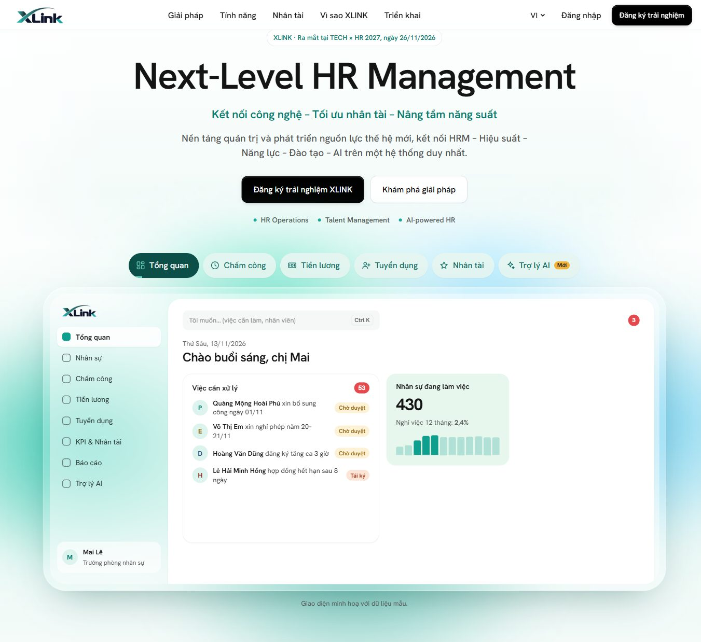
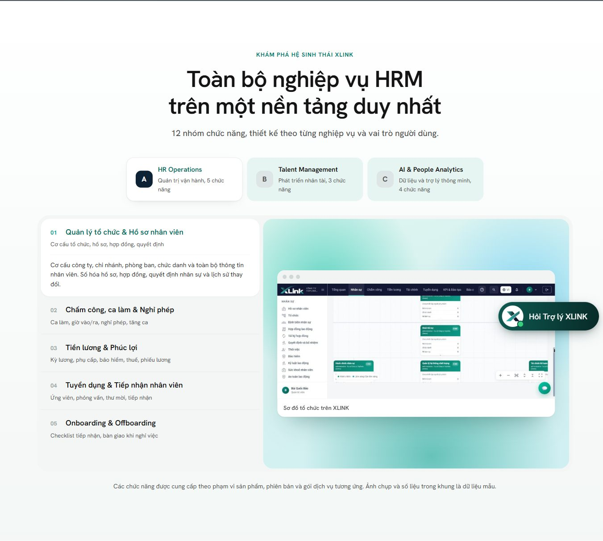
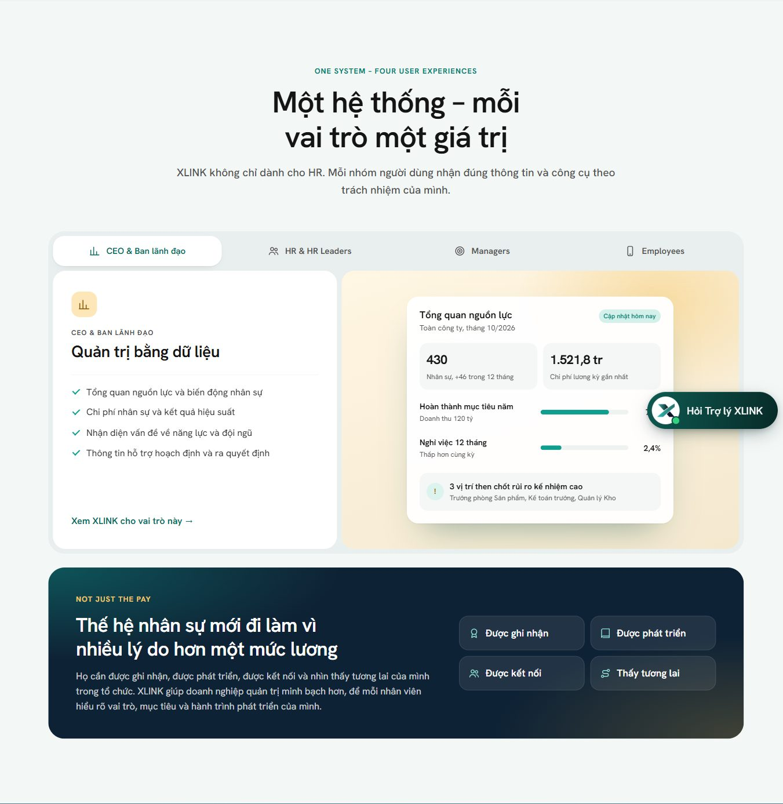
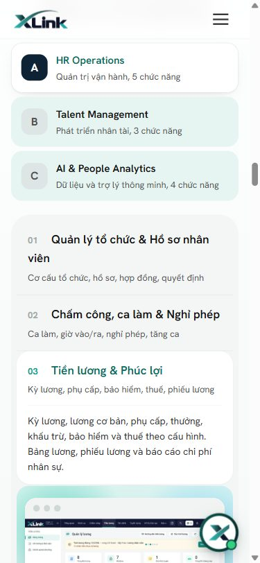

# XLINK – Bilingual SaaS landing page with a Git-based CMS

Landing page for **XLINK – Next-Level HR Management**, an HRM and talent-management SaaS by TOPLINKS, launched at TECH × HR 2027. Hand-coded from the client's content brief, bilingual (English default, Vietnamese), with a content admin so the client edits text and images without touching code.

**Live demo:** [English](https://v3.xlink-landing.pages.dev) · [Tiếng Việt](https://v3.xlink-landing.pages.dev/vi)



| 12 feature groups: toggle + accordion + large visual | One system, four roles: role switcher |
|---|---|
|  |  |

## Highlights

- **Hand-coded, no framework.** Static HTML, CSS and vanilla JavaScript; responsive from 360 px phones to wide screens; `prefers-reduced-motion` support; ARIA tabs and accordions usable with the keyboard.
- **Interactive product storytelling.** Auto-playing app mockup with 6 animated screens, card carousel, accordion whose visual moves under the open item on phones, role switcher, clickable 9-Box matrix, scripted AI-assistant demo and a floating chat assistant.
- **Bilingual from one template.** 779 text units live in JSON (`vi` / `en`); a Python build step (BeautifulSoup) generates both pages and checks that nothing is left untranslated.
- **Git-based CMS for a non-technical client.** [Decap CMS](https://decapcms.org) at `/admin`: edit text in both languages and replace 25 images (logos, screenshots, share image). Every save is a commit; GitHub Actions rebuilds and deploys to Cloudflare Pages in under a minute.
- **Image pipeline.** Uploaded images are resized and compressed to WebP (Pillow) at build time; only the optimized copies are published.
- **Serverless OAuth.** GitHub login for the CMS runs on Cloudflare Pages Functions, with a state-cookie CSRF check and a fallback for popups whose `window.opener` is cut by GitHub's Cross-Origin-Opener-Policy.
- **Tested like a user.** Playwright scripts click every interactive area on desktop and on a touch phone viewport, in both languages (navigation, form validation, tabs, carousels, assistant, language switch, no horizontal overflow).

<p align="center"></p>

## Tech stack

HTML · CSS · JavaScript · Python (BeautifulSoup, Pillow) · Decap CMS · Cloudflare Pages + Pages Functions · GitHub Actions · Playwright

## How it works

```
content/*.json ──┐                        ┌─> dist/index.html (EN)
src/page.html  ──┼─ cms/build_site.py ────┼─> dist/vi.html    (VI)
i18n/*.json    ──┘   (+ image resize)     └─> dist/assets, admin/
        ▲                                              │
  /admin (Decap CMS) ── commit ──> GitHub ── Actions ──┘──> Cloudflare Pages
```

> Product name, logo and copy belong to TOPLINKS / XLINK. Names and figures shown inside the product mockups are sample data.

---

# Hướng dẫn vận hành (tiếng Việt, dành cho TOPLINKS)

Trang dựng theo file "XLINK-NOI DUNG LANDING PAGE.docx": Hero · Thách thức · Giải pháp (3 trụ cột) · 12 nhóm chức năng · Trợ lý AI · Chu trình nhân tài · 4 vai trò · Vì sao XLINK · Triển khai · Đăng ký. Tiếng Anh là ngôn ngữ mặc định (`index.html`), tiếng Việt ở `vi.html`.

Bản đang chạy: https://v3.xlink-landing.pages.dev · Trang quản trị: https://v3.xlink-landing.pages.dev/admin/

## Sửa nội dung (dành cho TOPLINKS)

1. Mở `/admin/`, bấm **Đăng nhập bằng GitHub** (tài khoản GitHub phải được mời vào repo).
2. Chọn khối cần sửa (ví dụ "02 · Thách thức"), bấm mũi tên ở đoạn muốn đổi.
3. Sửa ô **Tiếng Việt** và ô **English**. Để trống ô English thì trang tiếng Anh dùng chữ tiếng Việt.
4. Bấm **Công bố → Công bố ngay**. Trang tự cập nhật sau khoảng 1–2 phút.

Đổi ảnh: mở khối **"Hình ảnh – logo, ảnh chụp màn hình, ảnh chia sẻ"**, bấm mũi tên ở ảnh muốn đổi → **Chọn hình khác** → chọn file từ máy → **Công bố → Công bố ngay**. Ảnh được tự thu nhỏ và nén (WebP) khi đưa lên trang; bản gốc chỉ lưu trong repo. Bấm "Gỡ bỏ hình" thì trang dùng lại ảnh gốc.
- Đổi được 25 vị trí: 3 logo, biểu tượng Trợ lý, ảnh chia sẻ link, 8 ảnh chụp ở khối 12 chức năng, 11 ảnh của dải chạy ngang, ảnh nền chân trang.
- Giao diện app ở đầu trang và các khung minh hoạ (KPI, 9-Box, IDP…) là hình vẽ bằng code: sửa được chữ, không thay bằng ảnh.

Lưu ý khi sửa:
- Giữ nguyên các thẻ như `<b>…</b>`, `<br>` nếu đoạn chữ có sẵn.
- Trang quản trị sửa **chữ** (779 đoạn, gồm tiêu đề tab và mô tả khi chia sẻ) và **25 ảnh**. Đổi bố cục, thêm khối, đổi hình minh hoạ vẽ bằng code vẫn cần sửa code.
- Một số chữ nằm trong code JavaScript, chưa sửa được trên trang quản trị: thông báo của form, giải thích từng ô 9-Box, chữ trong ảnh app chạy tự động.

## Cách trang được dựng

```
src/page.html        Khung trang (HTML) – mỗi đoạn chữ sửa được có data-c="mã"
content/*.json       Nội dung sửa được: 15 khối chữ ("vi", "en") + 15-hinh-anh.json (ảnh)  ← trang quản trị ghi vào đây
assets/img/uploads/  Ảnh gốc tải lên từ trang quản trị
i18n/*.json          Bản dịch cho vài đoạn cố định (có biểu tượng giữa câu) và chữ trong thuộc tính alt/aria
cms/build_site.py    Ghép khung + nội dung → dist/vi.html, dist/index.html, chép assets/, admin/, _headers
cms/extract_content.py, cms/add_images.py  (dùng một lần) tách chữ và ảnh từ trang cũ ra content/
admin/               Trang quản trị Decap CMS (index.html, config.yml)
functions/api/       Đăng nhập GitHub cho trang quản trị (Cloudflare Pages Functions)
.github/workflows/   Mỗi lần lưu trên /admin: tự dựng lại và đưa lên Cloudflare
assets/              CSS, JS, ảnh, video
```

Dựng và xem trên máy:

```
python -I cms/build_site.py
python -I serve.py 5175        # phục vụ dist/, mở http://localhost:5175
```

Thử trang quản trị trên máy (ghi thẳng vào content/, không cần GitHub): chạy `npx decap-server` trong thư mục này, rồi mở http://localhost:5175/admin/ và bấm Đăng nhập.

## Thiết lập một lần để /admin chạy trên mạng

1. **Repo GitHub** chứa thư mục này, nhánh `main`. Tên repo đã điền trong `admin/config.yml`: `Tay-Tran/xlink-landing`.
2. **GitHub OAuth App** (GitHub → Settings → Developer settings → OAuth Apps → New):
   - Homepage URL: `https://v3.xlink-landing.pages.dev`
   - Authorization callback URL: `https://v3.xlink-landing.pages.dev/api/callback`
3. **Cloudflare Pages** → project `xlink-landing` → Settings → Variables and Secrets: thêm `GITHUB_CLIENT_ID` và `GITHUB_CLIENT_SECRET` (lấy từ OAuth App, để dạng Secret), áp dụng cho Preview (nhánh v3 là preview).
4. **GitHub repo** → Settings → Secrets and variables → Actions: thêm `CLOUDFLARE_API_TOKEN` (token quyền *Cloudflare Pages: Edit*) và `CLOUDFLARE_ACCOUNT_ID`.
5. Mời tài khoản GitHub của người sửa nội dung vào repo (quyền Write).

Đưa lên thủ công (khi chưa nối GitHub): chạy `deploy-xlink-v3.ps1` ở thư mục cha.

## Còn để trống / cần thay

- `FORM_ENDPOINT` trong `assets/js/main.js` trống: form chưa gửi dữ liệu đi đâu.
- Tên người, số liệu trong giao diện app, các khung minh hoạ và Trợ lý demo là dữ liệu mẫu.
- Video trong `assets/video/` là bản dựng thử (khối video không dùng ở v3).
